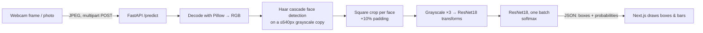

# Expression Detector

Real-time facial expression recognition in the browser. A **FastAPI** backend serves a **PyTorch
ResNet18** trained on **FER-2013**, and a **Next.js** frontend runs it on your webcam or on uploaded
photos.


> **Note:** This app detects facial *expressions*, not actual feelings. Images and frames are
> processed in memory and never stored.

## Features

- **Live camera mode:** the mirrored webcam feed gets color-coded boxes and labels (`happy 87%`)
  about twice a second. A side panel shows probability bars for the largest face, plus the
  request latency.
- **Upload photo mode:** drag-and-drop or click to upload (images only, max 5 MB). The preview
  gets numbered boxes and there is a results list for every face.
- **Multi-face:** all detected faces are classified in a single batch.
- **Confidence threshold:** low-confidence predictions are shown as "not sure".
- **7 expressions:** angry, disgust, fear, happy, neutral, sad, surprise. The names are read from
  the model checkpoint.
- **Privacy:** the backend never writes images to disk.
- **Responsive UI** with light and dark mode, a backend status indicator, and clear error messages
  for a denied camera or an unreachable backend.

## How it works



1. **Decode:** the image is opened with Pillow, rotated according to its EXIF tag (phone photos),
   and converted to RGB.
2. **Detect:** OpenCV's Haar cascade finds faces on a grayscale copy. Images wider than 640 px are
   downscaled for speed, and the boxes are scaled back to original coordinates.
3. **Crop:** each face becomes a square crop with ~10% padding, clamped to the image edges. This
   roughly matches how FER-2013 faces are framed.
4. **Preprocess:** exactly the same as in training:
   `Grayscale(num_output_channels=3)` → `ResNet18_Weights.DEFAULT.transforms()`
   (resize 256 → center-crop 224 → tensor → ImageNet normalization).
5. **Classify:** all crops run through ResNet18 in one batch under `torch.no_grad()`. Softmax
   turns the scores into probabilities.

### The model

`backend/emotion_model.pt` is a torchvision **ResNet18** fine-tuned on FER-2013 with transfer
learning in Google Colab. Its final layer is replaced with a 7-class linear layer. The checkpoint
is a dict:

```python
{"state": state_dict, "classes": ["angry", "disgust", "fear", "happy", "neutral", "sad", "surprise"]}
```

It is loaded with `torch.load(..., map_location="cpu", weights_only=True)`.

## Project structure

```
.
├── backend/
│   ├── main.py              # FastAPI app: model loading, face detection, /predict, /health
│   ├── emotion_model.pt     # trained weights + class names (~45 MB)
│   └── requirements.txt
├── frontend/
│   ├── app/                 # page (tabs), layout, global styles
│   ├── components/          # LiveCamera, UploadPhoto, ProbabilityBars, BackendStatus
│   ├── lib/                 # api.ts (API client, types, colors), draw.ts (canvas overlay)
│   └── .env.example
└── README.md
```

## Quick start

You need **Python 3.10+** and **Node.js 20.9+**. Use two terminals.

```bash
git clone https://github.com/SameerFeroz663/expression-detector.git
cd expression-detector
```

**Terminal 1: backend**

```bash
cd backend
python -m venv .venv
# Windows PowerShell: .venv\Scripts\Activate.ps1
# macOS / Linux:      source .venv/bin/activate
pip install --upgrade pip
pip install torch torchvision --index-url https://download.pytorch.org/whl/cpu
pip install -r requirements.txt
uvicorn main:app --port 8000
```

**Terminal 2: frontend**

```bash
cd frontend
npm install
npm run dev
```

Open **http://localhost:3000**, click **Start camera** and allow camera access. You can also
switch to **Upload photo**.

## Setup details

### Backend

**Why install torch separately?** On Linux, a plain `pip install torch` downloads the CUDA build,
which is several GB. The server only uses the CPU, so install torch and torchvision from PyTorch's
CPU index **first**. `pip install -r requirements.txt` then keeps those CPU builds. (On Windows and
macOS the default wheels are already CPU-only, but the same commands work everywhere.)

| Shell | Activate the venv |
| --- | --- |
| Windows PowerShell | `.venv\Scripts\Activate.ps1` |
| Windows cmd | `.venv\Scripts\activate.bat` |
| macOS / Linux | `source .venv/bin/activate` |
| Git Bash | `source .venv/Scripts/activate` |

Run with `uvicorn main:app --port 8000`. Add `--reload` while developing. On startup you should see
`Model loaded with classes: [...]`.

**Configuration**

| Variable | Default | Description |
| --- | --- | --- |
| `CONFIDENCE_THRESHOLD` | `0.5` | Minimum top probability for a prediction to be `"sure"` |

```bash
# PowerShell
$env:CONFIDENCE_THRESHOLD = "0.6"; uvicorn main:app --port 8000
# macOS / Linux
CONFIDENCE_THRESHOLD=0.6 uvicorn main:app --port 8000
```

CORS allows `http://localhost:3000` and `http://127.0.0.1:3000`. To serve the frontend from
another origin, add it to `allow_origins` in `backend/main.py`.

### Frontend

| Variable | Default | Description |
| --- | --- | --- |
| `NEXT_PUBLIC_API_URL` | `http://localhost:8000` | URL of the FastAPI backend |

To change it, copy `frontend/.env.example` to `frontend/.env.local`, edit it, and restart
`npm run dev`. For a production build, run `npm run build && npm start`.

> Browsers only allow camera access on `localhost` or over HTTPS.

## API

### `GET /health`

```json
{"status": "ok", "classes": ["angry", "disgust", "fear", "happy", "neutral", "sad", "surprise"]}
```

### `POST /predict`

Send `multipart/form-data` with the image in a field named **`file`** (max 5 MB).

```json
{
  "image_width": 1280,
  "image_height": 720,
  "faces": [
    {
      "box": [512, 140, 220, 220],
      "emotion": "happy",
      "confidence": 0.8731,
      "sure": true,
      "probabilities": [
        {"label": "happy", "probability": 0.8731},
        {"label": "neutral", "probability": 0.0612},
        {"label": "surprise", "probability": 0.0254}
      ]
    }
  ]
}
```

- `box` is `[x, y, width, height]` in the uploaded image's pixels.
- `probabilities` lists all 7 classes, highest first (shortened above).
- No faces → `"faces": []` with status `200`.

| Status | When |
| --- | --- |
| `400` | missing file, non-image, or unreadable/corrupt image |
| `413` | file larger than 5 MB |

Errors are JSON: `{"detail": "..."}`.

## Testing the backend

### From the interactive docs

1. Start the backend and open **http://localhost:8000/docs**.
2. **GET /health** → *Try it out* → *Execute*. You should get status 200 and the 7 class names.
3. **POST /predict** → *Try it out* → choose a photo with a face → *Execute*.
4. Try a `.txt` file (expect 400) and a photo without faces (expect `"faces": []`).

### With curl

```bash
curl http://localhost:8000/health
curl -X POST http://localhost:8000/predict -F "file=@path/to/photo.jpg"
```

On Windows PowerShell use `curl.exe` (plain `curl` is an alias for `Invoke-WebRequest` there):

```powershell
curl.exe -X POST http://localhost:8000/predict -F "file=@C:\path\to\photo.jpg"
```

## Troubleshooting

| Problem | Fix |
| --- | --- |
| UI says **"Backend unreachable"** | Start uvicorn and check `NEXT_PUBLIC_API_URL`. |
| **Camera access denied** | Click the camera icon in the address bar, allow access, then press *Start camera* again. |
| **"Camera is already in use"** | Close other apps or tabs that use the webcam. |
| `module 'cv2' has no attribute 'CascadeClassifier'` | OpenCV 5 removed Haar cascades from the main package. `requirements.txt` pins `opencv-python-headless<5`, so reinstall with `pip install -r requirements.txt`. |
| **No faces found** | The Haar detector works best on frontal, well-lit faces at least ~48 px tall. |

## Limitations

- FER-2013 contains 48×48 grayscale faces with noisy labels and class imbalance (very few
  "disgust" examples). Expect mistakes, especially between similar expressions such as
  fear/surprise and sad/neutral.
- Haar cascades miss faces that are turned sideways, partly covered, or poorly lit.
- A facial expression is not the same as an emotion. Don't use this to make decisions about
  people.

## Acknowledgements

- [FER-2013](https://www.kaggle.com/datasets/msambare/fer2013) dataset
- [PyTorch / torchvision](https://pytorch.org/) ResNet18 pretrained on ImageNet
- [OpenCV](https://opencv.org/) Haar cascade face detector
